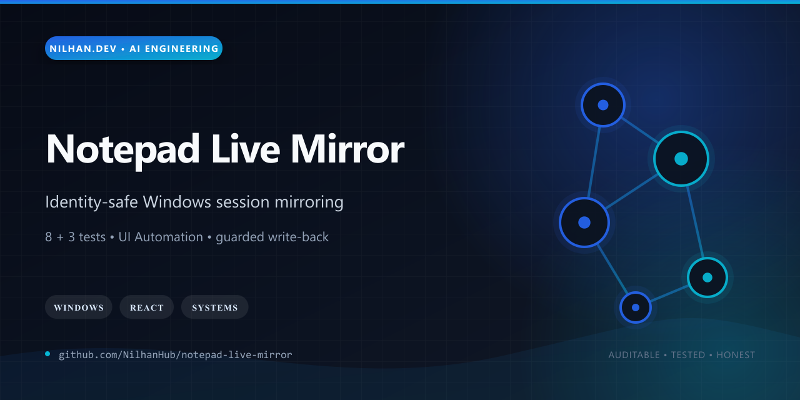
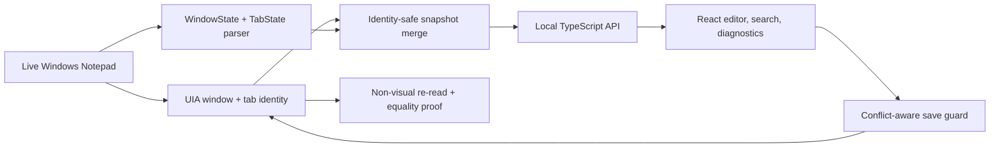

# Notepad Live Mirror

[](https://github.com/NilhanHub/notepad-live-mirror/actions/workflows/ci.yml)
[](LICENSE)
[](docs/for-oracle-to-read.md)



Notepad Live Mirror is a local-first Windows systems project that mirrors the real multi-tab state of stock Windows 11 Notepad into a browser workspace—without opening a replacement editor or silently stepping through the user's tabs.

Its interesting engineering problem is identity and truth, not just text display. The bridge combines Windows UI Automation metadata with Notepad's local session-state files, binds snapshots to window and tab identities, guards write-back against stale content, restores selection, and re-reads the live session before claiming success.

## Why it stands out

- Reads every open tab non-visually from `WindowState` and `TabState` while cross-checking the active document through UIA.
- Uses exact window-handle, state-id, and runtime-id evidence instead of guessing from tab titles.
- Treats save as a bounded transaction: compare, select, write, restore, re-read, and verify equality.
- Adds local search, retrieval-first answers with source passages, diagnostics, and sanitized verification artifacts.
- Includes a React/TypeScript interface, Express API, PowerShell UIA adapter, and desktop launcher.
- The public release passes **8 unit tests**, a production build, and **3 Playwright UI scenarios**, with zero known npm advisories.



## Runtime stack

- React + TypeScript + Vite frontend
- Node.js + Express local API
- PowerShell + Windows UI Automation bridge
- TypeScript Notepad session-state parser
- Vitest and Playwright verification

## Quick start

On Windows 11 with stock Notepad available:

```powershell
npm ci
npm test
npm run verify:headless
.\run-local.cmd
```

The launcher builds the app, selects the first free local port beginning at `43117`, opens the interface, and performs one live sync.

## Verification commands

- `npm test` — unit tests
- `npm run verify:headless` — build plus Playwright UI checks
- `npm run inspect:notepad` — read-only live session inspection
- `npm run inspect:tree` — sanitized UIA selector evidence
- `npm run smoke:live` — read-only real-user smoke verification
- `npm run audit:real` — sanitized real-user audit

## Maturity and bounded risks

This is a Windows-specific engineering prototype. Snapshot, search, and query are non-visual; save still uses a bounded UIA write path and is not presented as risk-free. File-backed ANSI tabs currently assume Windows-1252, and multi-window matching should be revisited if Microsoft changes Notepad's session format. The public release contains source and sanitized fixtures, not the developer's live Notepad data or machine-local evidence archives.

See [SECURITY.md](SECURITY.md), [CONTRIBUTING.md](CONTRIBUTING.md), and [RIGHTS.md](RIGHTS.md).
